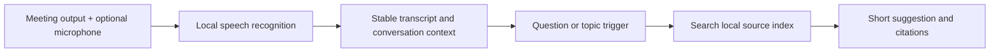

# Using the teleprompter in an online meeting

Join Google Meet, Zoom or Teams normally. The teleprompter is a separate Windows app: it does not join the call, speak, or send messages. It listens through the audio device you select and shows assistance on your screen.

## Before the call

1. Open **Sources** and add the notes, project documents or public web pages you want it to use. Files are indexed locally. Saved pages refresh only when explicitly requested.
2. Open **Audio settings** and choose the **same output device your meeting uses**. If your call plays through a headset, select that headset rather than the laptop speakers.
3. Choose whether to include your microphone. With it off, only the selected output is captured. With it on, your speech appears as **You**, while the other side appears as **Call**. Microphone capture is independent of the meeting client's mute button. Use headphones to reduce echo.
4. Join the meeting and click **Start session**. The app prepares local speech recognition, then shows the listening indicator, elapsed time and audio meters. Audio is off before you start. Use capture in accordance with participant consent and your organization's policy.

## While people are talking

The transcript contains partial and final text. Questions, topic changes and useful claims can trigger source search and a short local draft without a typed prompt. Source-based answers keep citations; general background has a separate label. Insufficient evidence and resource limits are shown rather than silently inventing a sourced answer.

The **Updated Ns ago** indicator refers to the latest transcript update, not measured inference latency. Silence does not itself indicate a failure.

## Controls during a call

| Control | What it does |
| --- | --- |
| **Meeting view** | Makes a compact window above the call. Secondary panes hide and answers get more space. It does not change audio capture. |
| **Workspace** | Restores the previous window size, position and always-on-top preference. |
| **Auto assist — Paused** | Cancels automatic drafting and stops new automatic suggestions. Audio capture and transcription continue. Manual questions still work. Resume applies to new speech. |
| **Ask a question** | Expands the question composer in meeting view. Enter or **Ask** submits the question. |
| **Answer latest** | Requests help with the latest stable discussion, regardless of older text left in the question box. |
| **Evidence** | Retrieves source passages about the latest discussion. It does not require language-model generation. |
| **Cancel answer** | Cancels the current assistance request; the live transcript continues. It stays accessible in compact view while a draft is running. |
| **Explore answer** | Provides concise answer, evidence, explanation, claim check and follow-up routes for that card's context. |
| A citation | Opens the actual evidence passage with its heading/page/chunk and original location. |
| **… → Export transcript** | Saves the retained transcript explicitly, including while the transcript pane is hidden in meeting view. |
| **End & clear** | Stops capture and clears the in-memory transcript and cards. Export first if you want a copy. Closing the app also clears the session. |

Use **Only my sources** for source-only answers. **Sources first** also permits clearly labeled general background when the sources do not cover an appropriate question. Those settings do not enable live web search.

## Audio, privacy and delay

Capture includes other sounds played through the selected output, such as notifications or music; it is not restricted to one conferencing process. The app does not identify individual remote speakers. Selecting a different meeting device requires stopping the session and changing audio settings.

Speech recognition, source search, embeddings and generation run on this computer. Fetching an explicitly added/refreshed web page uses the network. The widget can be visible in whole-screen sharing; choose the intended application/window when keeping your notes separate.

This is windowed local transcription, not instant closed captions. Speech windows, local processing and generation add delay. Earlier measurements on this laptop varied substantially with background load, and the combined latency/RAM goals remain unaccepted. Auto assist can be paused to avoid unnecessary generation; **Evidence** stays useful when memory conservation prevents generation. See [the measured limitations](VALIDATION.md).

## UI verification

`scripts/render-ui.ps1` runs an isolated, explicitly labeled preview with fictional content. It creates no capture source or inference workers, renders the actual XAML tree, and checks essential controls in ready, live workspace, compact, draft, question, library and narrow layouts. Images and layout reports stay under `artifacts/ui-live-review`.

Render checks do not cover native title bars, popup dialogs, pointer/keyboard interaction or sustained real calls. Those remain separate desktop checks.

Implementation references: Microsoft's [window management](https://learn.microsoft.com/en-us/windows/apps/develop/ui/manage-app-windows), [responsive layout guidance](https://learn.microsoft.com/en-us/windows/apps/design/layout/screen-sizes-and-breakpoints-for-responsive-design), and [XAML rendering API](https://learn.microsoft.com/en-us/windows/windows-app-sdk/api/winrt/microsoft.ui.xaml.media.imaging.rendertargetbitmap).
